<p align="center">
  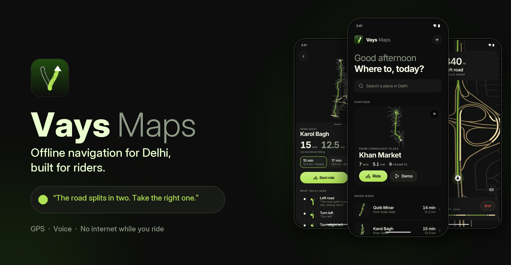
</p>

<p align="center">
  <a href="https://github.com/Shivanshxsharma/vays-maps/releases/latest"></a>
  
  
  
  <a href="LICENSE"></a>
</p>

<h3 align="center">Navigation that tells riders <i>which road</i> to take, by position, never by name.</h3>

<p align="center">
  <a href="https://github.com/Shivanshxsharma/vays-maps/releases/latest/download/VaysMaps.apk"><b>Download the APK</b></a>
  &nbsp;·&nbsp; <a href="#what-youll-hear">What you'll hear</a>
  &nbsp;·&nbsp; <a href="#screens">Screens</a>
  &nbsp;·&nbsp; <a href="#how-it-works">How it works</a>
  &nbsp;·&nbsp; <a href="#build-it">Build it</a>
</p>

<br>

## Why

Riding through Delhi with one earphone in, "turn onto Sri Aurobindo Marg" doesn't help. You can't read signs at 50 km/h, and half the roads have three names. What you actually need to know is simpler: **the road ahead splits, which one do I take?**

Vays Maps counts the roads you'll see at every split and tells you which one, left to right. It also knows when one of them climbs a flyover or dips into an underpass. Download a ride while you're online; ride it with no internet at all.

<br>

## What you'll hear

<table>
  <tr>
    <td width="50%">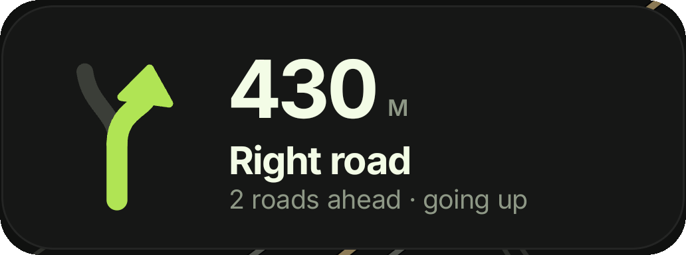</td>
    <td width="50%">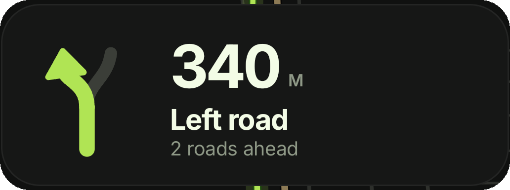</td>
  </tr>
  <tr>
    <td><i>"In 400 metres, the road splits in two. Take the right one, going up."</i></td>
    <td><i>"The road splits in two. Take the left one."</i></td>
  </tr>
</table>

| At the split | Vays Maps says |
|---|---|
| Two roads, one goes up a flyover | "The road splits in two. Take the right one, going up." |
| Three roads (service lane, flyover, service lane) | "Three roads ahead. Take the middle one." |
| Four roads | "Four roads ahead. Take the second one from the left." |
| A junction with a signal | "At the signal, turn left." |
| A roundabout / Connaught Place | "At the roundabout, take the second exit." / "Join the circle and keep left." |
| Over the limit | "Slow down. The limit here is 60." (once, then quiet) |

The icon on screen draws every road at the split and fills in yours, so a one-second glance says the same thing as the voice.

<br>

## Screens

<table>
  <tr>
    <td align="center" width="33%">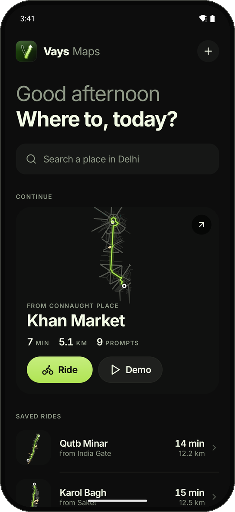<br><sub><b>Home</b><br>Where you are, saved places, your last ride</sub></td>
    <td align="center" width="33%">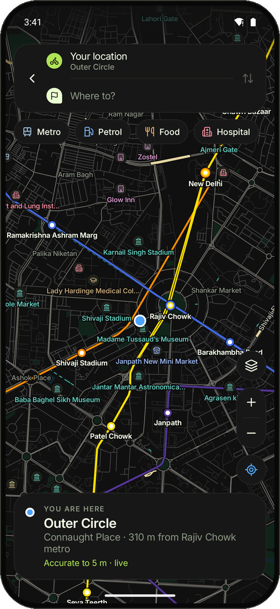<br><sub><b>You are here</b><br>Live dot, address, how accurate it is</sub></td>
    <td align="center" width="33%">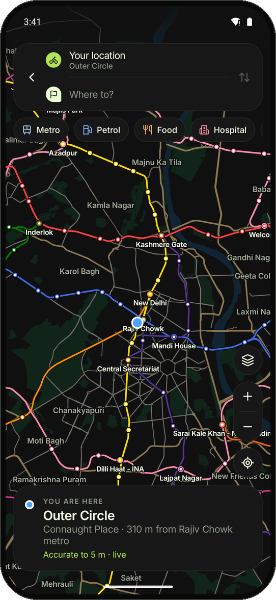<br><sub><b>Delhi Metro</b><br>Every line in its own colour, all interchanges</sub></td>
  </tr>
  <tr>
    <td align="center" width="33%">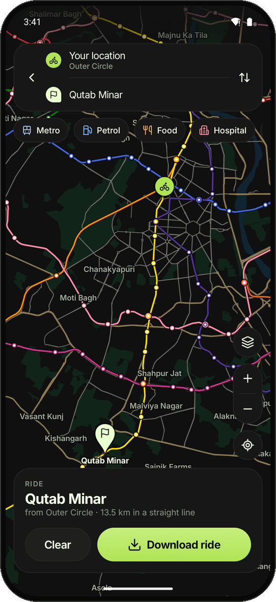<br><sub><b>Pickup and destination</b><br>A bike badge for the start, a flag pin for the end</sub></td>
    <td align="center" width="33%">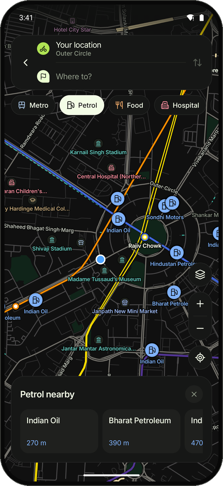<br><sub><b>Nearby</b><br>Petrol, food, hospitals, ATMs, metro</sub></td>
    <td align="center" width="33%">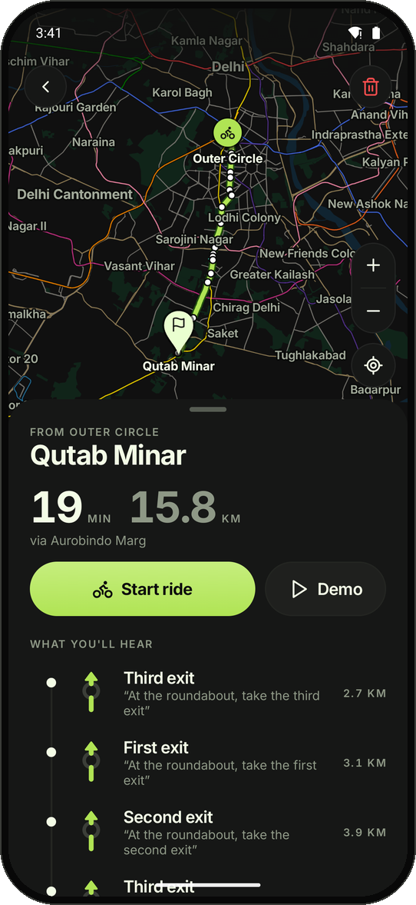<br><sub><b>Ride preview</b><br>Routes, zoomable map, every prompt you'll hear</sub></td>
  </tr>
  <tr>
    <td align="center" width="33%">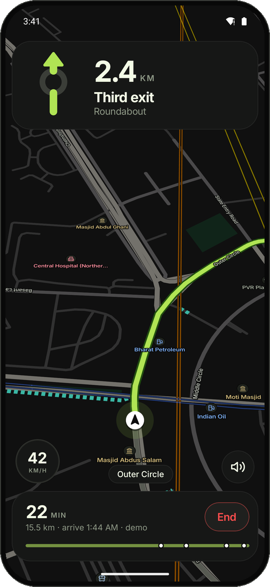<br><sub><b>Riding</b><br>Landmarks around you, pinch to zoom</sub></td>
    <td align="center" width="33%">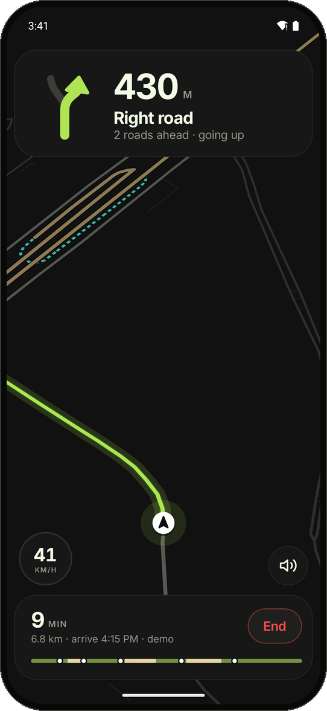<br><sub><b>At a split</b><br>Which road, counted from the left</sub></td>
    <td align="center" width="33%">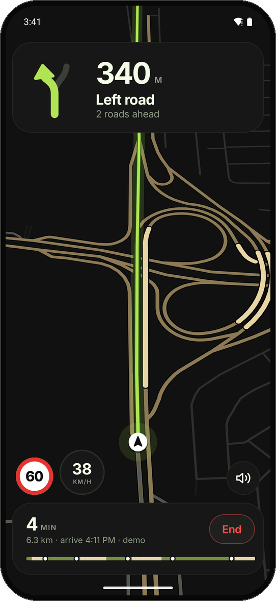<br><sub><b>Speed limits</b><br>AIIMS interchange, 60 km/h zone</sub></td>
  </tr>
</table>

<br>

## Features

<table>
  <tr>
    <td width="50%" valign="top">
      <h4>Built for riders</h4>
      Prompts by position (left, middle, right, second from the left), short enough for one earphone and early enough to change lanes. Timing scales with your speed: about 40, 13 and 4 seconds ahead.
    </td>
    <td width="50%" valign="top">
      <h4>Offline, for real</h4>
      Download a ride once; GPS, voice, re-routing, speed and arrival time all work with no internet. Rides are usually 60–200 KB because only a ~250 m strip around the route is saved.
    </td>
  </tr>
  <tr>
    <td valign="top">
      <h4>Knows Delhi's flyovers</h4>
      Every split is checked for a flyover, an underpass or a service lane within 230 m. If you stay below when you should have gone up, it notices within a few seconds and re-routes, even though the two roads are only ~15 m apart.
    </td>
    <td valign="top">
      <h4>Speed aware</h4>
      Live speedometer, the road's limit sign where OpenStreetMap has it, one calm warning when you're over, and an arrival time that learns your real pace, stops at signals included.
    </td>
  </tr>
  <tr>
    <td valign="top">
      <h4>A map you can read at a glance</h4>
      All of Delhi is in the app (284 KB): main roads, the river, parks, areas and the whole metro in official colours. Zoom in and streets, flyovers, shops, petrol pumps and gates appear; each ~9 KB area is kept for offline use. Lime is the route and nothing else.
    </td>
    <td valign="top">
      <h4>No backend to run</h4>
      Delhi's roads live in this repo as 2,521 small tiles (22 MB in total). The app downloads the few it needs straight from GitHub. Nothing to deploy.
    </td>
  </tr>
  <tr>
    <td valign="top">
      <h4>Finds the small places too</h4>
      216,000 shops, restaurants, chemists, garages, colonies and roads, inside the app and searchable offline. Spelling is forgiven (Shree/Sri/Shri, Qutub/Qutab), "puncture shop" or "chemist near me" gives the nearest, and "dosa corner paschim vihar" looks in Paschim Vihar. Missing one? Tap the spot and add it.
    </td>
    <td valign="top">
      <h4>Knows where you really are</h4>
      GPS plus network location, with the address, accuracy and age of the fix on screen, so you can confirm it before you ride. Off the mark? Tap the right spot and choose "Start here". Offline it still says "DTC Colony, at Shadipur metro".
    </td>
  </tr>
  <tr>
    <td valign="top">
      <h4>Works with the screen off</h4>
      Voice and GPS carry on in your pocket, with the next turn on the lock screen. Pinch to zoom while it follows you; drag to look around and it comes back by itself.
    </td>
  </tr>
</table>

<br>

## How it works

<p align="center">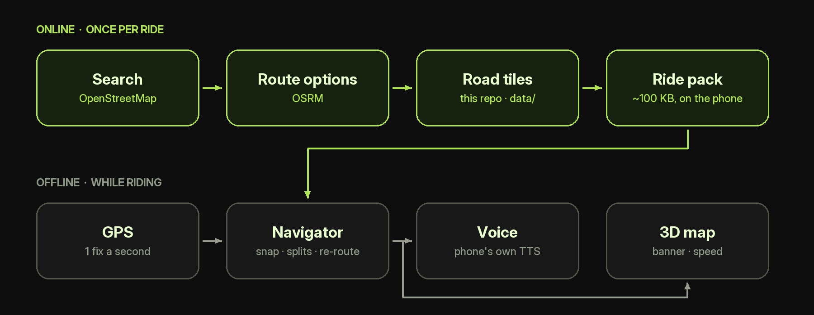</p>

<details>
<summary><b>Under the hood</b></summary>
<br>

<p align="center">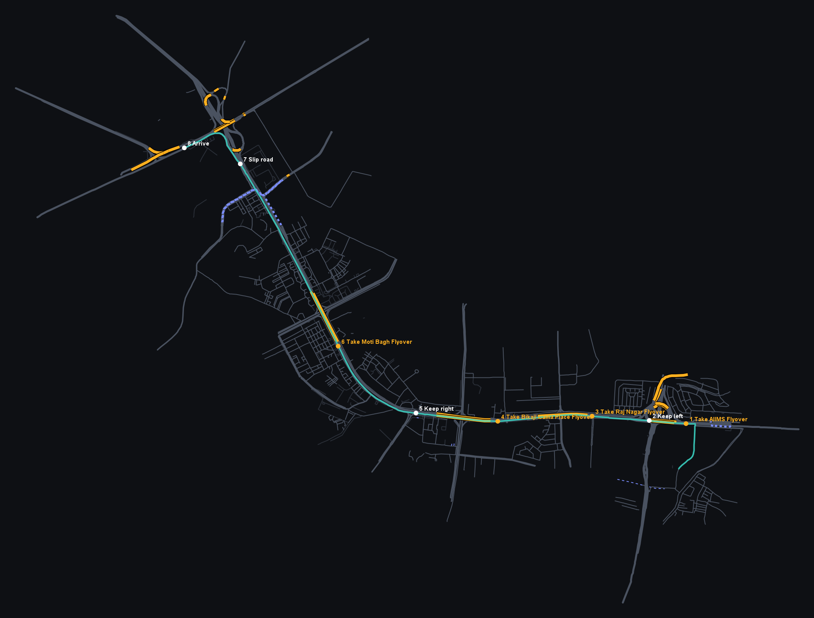<br>
<sub>What the engine sees for AIIMS → Dhaula Kuan: the downloaded corridor, flyover decks, the route and each decision point.</sub></p>

* **Guidance** (`core/Guidance.kt`, `core/Phrases.kt`): at every split, count the look-alike roads a rider will see (2–4, left to right, driveways ignored) and pick yours by position. Check each branch for a real flyover (a bridge longer than 100 m, or one named "Flyover") or an underpass within 230 m; short bridges over nallahs and railway lines are ignored. Big circles like Connaught Place get "join the circle"; two quick turns across a median become a U-turn.
* **Navigator** (`core/Navigator.kt`): snaps GPS to the route, speaks at speed-scaled distances, watches the roads you weren't meant to take for 450 m after each split (that's how "stayed below the flyover" is caught), and re-routes offline with an edge-based A* that knows India drives on the left.
* **Route matching**: OSRM's JSON rounds long OSM node ids and sometimes uses private lanes the tiles leave out, so routes are aligned to the map by coordinate, with detours and a corridor fallback.
* **Place search** (`core/PlaceDb.kt`): a memory-mapped file with a spatial grid and a word index; matches by word, beginning, sound and typo, resolves areas, kinds and initials, ranks by fit, certainty and distance. `tools places` builds it from Overture Maps and OpenStreetMap, throwing out wrong pins and duplicates.
* **Online search** (`core/Online.kt`): only if you ask for more; merges two free OpenStreetMap search services (Nominatim and Photon). Words like "metro station" or "restaurant" are read as the kind of place you want, not as part of its name, so results of that kind rank first and each one is labelled.
* **Tiles** (`tools/`): a small dependency-free PBF reader cuts Delhi out of the Geofabrik northern-India extract into ~1.1 km gzip'd JSON tiles.
* **App** (`app/`): Jetpack Compose, a custom map engine (ground painted into cached tiles on background threads; labels, route and markers drawn live on top; gentle 3D tilt), Lucide icons, Inter type, iOS-style transitions.

</details>

<br>

## Project layout

| Path | What's inside |
|---|---|
| [`core/`](core) | Pure Kotlin engine, no dependencies: road graph + A*, guidance, phrases, navigator, ride packs, tile loader. Runs on Android and on a PC. |
| [`app/`](app) | The Android app (Jetpack Compose). |
| [`tools/`](tools) | PC command line: cut tiles, build and print ride packs, render previews, simulate rides. |
| [`data/`](data) | Delhi road tiles the app downloads (ODbL). |
| [`testdata/`](testdata) | Sample rides around Delhi and their engine renders. |

<br>

## Build it

Needs JDK 17 and the Android SDK.

```powershell
.\gradlew :core:test                 # 31 engine, map and search tests on real Delhi data
.\gradlew :app:assembleRelease       # app/build/outputs/apk/release/app-release.apk
.\gradlew :tools:installDist         # tools/build/install/tools/bin/tools
```

<details>
<summary><b>PC tools</b></summary>

```powershell
# Refresh the Delhi tiles (northern India extract from Geofabrik, ~225 MB)
curl.exe -L -o data-src/northern-zone.osm.pbf https://download.geofabrik.de/asia/india/northern-zone-latest.osm.pbf
tools\build\install\tools\bin\tools tiles data-src\northern-zone.osm.pbf data

# Refresh the places (needs Python with pyarrow)
python tools/places/overture.py data-src/overture.tsv.gz
tools\build\install\tools\bin\tools places data-src\northern-zone.osm.pbf data-src\overture.tsv.gz
tools\build\install\tools\bin\tools find --at 28.668,77.100 "durga dosa corner"

# Build a ride from the tiles and print everything it will say
tools\build\install\tools\bin\tools build 28.5672,77.2100 28.5918,77.1615 testdata\aiims-dhaulakuan.rpk AIIMS "Dhaula Kuan"

# Draw the engine's view of a ride, or simulate riding it
tools\build\install\tools\bin\tools render testdata\aiims-dhaulakuan.rpk testdata\aiims-dhaulakuan.png
tools\build\install\tools\bin\tools sim testdata\aiims-dhaulakuan.rpk
```

Set `RAASTA_TILES` to a folder or URL to build from other tiles (default: `data/`).

</details>

<br>

## Status

- [x] Ride download end to end in the app: search → OSRM → tiles from this repo
- [x] Position-based voice, flyover / underpass cues, offline re-routing
- [x] Speedometer, speed limits, pace-based arrival time
- [x] Search that understands "Shadipur metro station", "restaurant in Connaught Place", "petrol pump Karol Bagh"
- [x] Live location with address, metro lines and stations, zoom-level map detail, nearby search, Home / Work
- [x] Rides with the screen off (foreground service)
- [x] 216,000 places offline, forgiving search, add a missing place
- [x] 31 tests on real Delhi routes, including "stayed below instead of taking the Raj Nagar Flyover → re-routed → still arrived"
- [ ] Road-tested on a real phone
- [ ] Hindi phrasebook
- [ ] Turn restrictions when re-routing offline
- [ ] Own routing (or on-phone routing) instead of the public OSRM demo server

<br>

## Licences

* Code: [MIT](LICENSE).
* Road tiles in `data/`: derived from OpenStreetMap, © OpenStreetMap contributors, [ODbL 1.0](data/README.md).
* Places: Overture Maps Foundation (CDLA-Permissive-2.0, Apache-2.0, CC0) and OpenStreetMap (ODbL), see [data/README.md](data/README.md).
* Inter font: [SIL Open Font License 1.1](LICENSES/Inter-OFL.txt). Icons: [Lucide](https://lucide.dev) (ISC).

<p align="center"><br><br><sub>Made for Delhi's riders.</sub></p>
